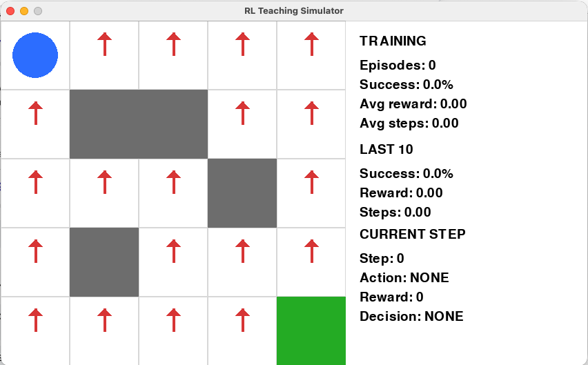
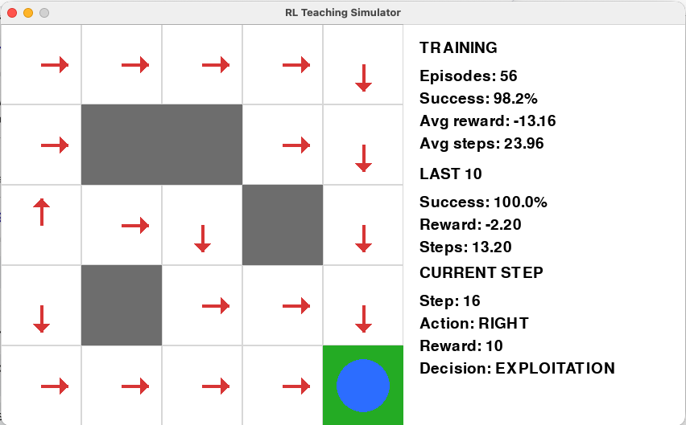

# RL Teaching Simulator 🧠

A visual, interactive simulator for learning the fundamental ideas behind
Reinforcement Learning.

# GridWorld Agent 🏓
The first project in this repository is a **GridWorld agent** that starts with
no knowledge of its environment and gradually learns how to reach its goal
through experience.

---

## From random decisions to a learned path

### Before training

At the beginning, the agent does not know where the goal is or which direction
it should take. Its decisions are based on initial, untrained value estimates.



### After training

After interacting with the environment over many episodes, the agent has learned
which actions are more valuable. The arrows show the learned policy—the
direction the agent has learned to take from each state.



The agent was never given a map or the correct path. It learned through trial,
error, rewards, and repeated updates to its estimates.

---

## How does the agent learn?

The learning process in this project is based on two closely related ideas:
the **Bellman equation** and the **Bellman update**.

The implementation can be found in:

`gridworld/src/rl/algorithms/q_learning.py`

## 1. The Bellman equation: What comes next matters

A decision is not valuable only because of the reward it gives immediately.
It can also be valuable because of where it leads.

The Bellman idea can be expressed as:

$$
Q(s, a) = r + \gamma \max_{a'} Q(s', a')
$$

In simple terms:

> **The value of a decision depends on the reward now and the best value that can come next.**

In the code, this idea appears when the agent calculates its learning target:

```python
target = reward + self.gamma * max_next_q
```

The agent combines:

- the **reward it received now**, and
- the **best value it expects from the next state**.

This allows an action to become valuable even when it does not immediately
produce the final reward. An action can be valuable because it leads the agent
toward another valuable state.

## 2. The Bellman update: Improving the value estimate

At the beginning, the agent does not know the true value of any action. It only
has an estimate based on what it has experienced so far.

After every new experience, it adjusts that estimate.

The Q-learning update is:

$$
Q^{*}(s,a)
=
\mathbb{E}\left[
r+\gamma\max_{a'}Q^{*}(s',a')
\mid s,a
\right]
$$


In simple terms, I find it helpful to think about the same idea as:

> **New value estimate = Old value estimate + Adjustment based on the current experience**

The adjustment is based on the difference between what the agent expected and
what it actually learned from the new experience.

In the Q-learning implementation, this appears as:

```python
error = target - current_q

new_q_value = (
    current_q
    + self.learning_rate * error
)
```

In simple terms:

> **Keep the old estimate, then move it slightly toward what the latest experience suggests.**

If the outcome is better than expected, the value estimate increases. If it is
worse than expected, the estimate decreases.

Over many experiences, these small adjustments gradually improve the agent's
understanding of which actions are likely to lead to better outcomes.

---

## The result

Together, these two ideas allow the agent to learn a path toward the goal:

- **The Bellman equation** helps the agent consider what might come next.
- **The Bellman update** helps the agent improve its value estimates based on experience.

The agent starts with no map and no knowledge of the correct path.

One experience at a time, it learns:

> **From where I am now, which action is most likely to lead me toward a better future?**

---

## Project structure

```text
RL-Teaching-Simulator/
│
├── README.md
├── assets/
│   ├── gridworld_before_training.png
│   └── gridworld_after_training.png
│
└── gridworld/
    └── src/
        └── rl/
            └── algorithms/
                └── q_learning.py
```

---

## Why this project?

Reinforcement Learning can sometimes feel highly mathematical and abstract.

This project was created to make those ideas easier to observe. Rather than
only reading about Q-values, rewards, exploration, and Bellman updates, the
goal is to see an agent start with no knowledge and gradually learn through
interaction with its environment.

More environments and reinforcement learning concepts will be added as the
project evolves.

# Pong DQN 🏓

The second project in **RL-Teaching-Simulator** explores how a reinforcement learning agent can learn to play Atari Pong automatically using a neural network.

Unlike GridWorld, where the agent learns from a small, discrete set of states, Pong presents a much more challenging problem. The agent receives visual observations of the game, must understand how the ball and paddle are moving, and learns which actions are likely to lead to better outcomes.

The agent is not given instructions on how to track the ball or when to move the paddle. It learns through repeated interaction, rewards, and experience.

---

## From random actions to learned gameplay

### Before training

Initially, the agent has no meaningful understanding of the game. It selects actions using randomly initialized Q-values and exploration.

Its objective is to learn which paddle movements are more valuable in different situations.

### After training

After training for one million environment steps, the agent begins to demonstrate meaningful gameplay. It moves its paddle in response to the ball, changes direction when necessary, and learns a policy that can achieve positive average rewards.

The final Vanilla DQN model achieved an average reward of **+0.42 over 100 evaluation episodes**, with each episode evaluated for up to 2,000 steps.

This is a significant improvement over the earlier stages of training, although the agent does not win consistently in every episode.

---

## How does the agent learn to play Pong?

The learning process builds on the same fundamental idea introduced in GridWorld: **the value of an action depends on both its immediate reward and what it can lead to in the future.**

The implementation is based on Deep Q-Learning, which combines Q-learning with a neural network.

The main training implementation can be found in:

`pong/run_dqn_pong.py`

The Q-learning update is implemented in:

`pong/src/training.py`

## 1. From a Q-table to a neural network

In GridWorld, the agent can maintain a table of Q-values for individual states and actions.

Pong is different. The agent receives images of the game, and the number of possible visual states is far too large to represent using a conventional Q-table.

Instead, a **Deep Q-Network (DQN)** uses a convolutional neural network to estimate Q-values directly from the visual state.

The network receives four consecutive frames of the game, each processed into an 84 × 84 grayscale image.

The four frames provide information about movement, allowing the agent to infer how the ball and paddle are changing position.

The neural network architecture is implemented in:

`pong/src/dqn.py`

The four-frame state representation is implemented in:

`pong/src/state.py`

## 2. The Bellman equation: What comes next matters

The Bellman equation provides the foundation for learning action values.

For Pong, the optimal action-value function can be expressed as:

$$
Q^*(s,a)=
\mathbb{E}\left[
r+\gamma\max_{a'}Q^*(s',a')
\mid s,a
\right]
$$

In simple terms:

> **The value of a paddle movement depends on the reward received and the best future outcome that can follow it.**

A paddle movement may not produce an immediate reward. However, moving into a better position may increase the probability of returning the ball and eventually scoring a point.

This is how the agent learns to value actions that contribute to future success rather than only reacting to immediate rewards.

## 3. The DQN target: Learning from experience

The neural network learns by comparing its current Q-value estimate with a target calculated from experience.

The DQN target is:

$$
y=r+\gamma\max_{a'}Q_{\text{target}}(s',a')(1-\text{done})
$$

The target combines:

- The **immediate reward** received after taking an action.
- The **discounted future value** estimated for the next state.
- A terminal-state mask that prevents future rewards from being added after an episode ends.

The implementation is in:

`pong/src/training.py`

The network gradually adjusts its parameters to reduce the difference between its current estimate and the calculated target.

## 4. Experience replay: Learning from past interactions

An important difference between this project and the GridWorld implementation is the use of **experience replay**.

Instead of learning only from the most recent interaction, the agent stores experiences containing:

- The current state
- The action taken
- The reward received
- The next state
- Whether the episode terminated

During training, the agent samples a batch of experiences from this replay buffer and learns from them.

This helps reduce the dependence between consecutive experiences and allows the agent to reuse previous interactions.

Implementation:

`pong/src/replay_buffer.py`

## 5. Target networks: Stabilizing learning

The DQN uses two neural networks:

- **Online network:** Learns and updates its parameters during training.
- **Target network:** Provides a more stable reference for calculating learning targets.

The target network periodically receives the online network's parameters rather than changing after every training update.

This helps reduce instability caused by continuously changing targets.

Implementation:

`pong/src/target_network.py`

## 6. Exploration and exploitation

The agent must balance two competing behaviours:

- **Exploration:** Trying different actions to discover better strategies.
- **Exploitation:** Choosing actions that currently have the highest estimated Q-values.

This project uses epsilon-greedy action selection.

At the beginning of training, the agent explores frequently. As training progresses, epsilon decreases, and the agent increasingly relies on its learned Q-values.

The final training configuration used:

- Initial epsilon: 1.0
- Final epsilon: 0.05
- Epsilon decay: 500,000 training steps
- Total training: 1,000,000 environment steps

Implementation:

`pong/src/action_selection.py`

The epsilon schedule and training configuration are defined in:

`pong/run_dqn_pong.py`

---

## The result: What did the agent learn?

The final Vanilla DQN model was evaluated over 100 episodes.

| Metric | Result |
|---|---:|
| Training steps | 1,000,000 |
| Evaluation episodes | 100 |
| Average reward | +0.42 |
| Average evaluation episode length | 2,000 steps |

The agent achieved positive average reward, although individual episodes varied considerably.

The project also explored different training durations and compared Vanilla DQN with Double DQN. These experiments demonstrated that additional training and changes to the learning algorithm do not necessarily guarantee improved performance.

Evaluation implementation:

`pong/evaluate_dqn_pong.py`

Behavioural diagnostics:

`pong/diagnose_dqn_pong.py`

---

## GridWorld versus Pong

The two projects illustrate how reinforcement learning can be extended from a simple environment to a much more complex problem.

| GridWorld | Pong |
|---|---|
| Discrete, small state space | High-dimensional visual state |
| Q-table | Neural network approximating Q-values |
| State directly represents position | State represented by stacked image frames |
| Tabular Q-learning | Deep Q-Learning |
| Learns a path to a goal | Learns a paddle-control policy |
| Relatively simple value updates | Experience replay and target networks |

The underlying principle remains the same:

> **The agent learns which actions are valuable by interacting with its environment and using rewards to improve its estimates.**

What changes is how the agent represents the state and how it learns to estimate action values.

---

## Watch the trained agent play Pong 🏓

The following video demonstrates the trained DQN agent playing Atari Pong.

https://github.com/user-attachments/assets/a88b87e3-4192-4beb-b4b5-0e44666842c9

## Project structure

```text
RL-Teaching-Simulator/
│
├── README.md
│
├── assets/
│   ├── gridworld_before_training.png
│   └── gridworld_after_training.png
│
├── gridworld/
│   └── src/
│       └── rl/
│           └── algorithms/
│               └── q_learning.py
│
└── pong/
    ├── run_dqn_pong.py
    ├── evaluate_dqn_pong.py
    ├── diagnose_dqn_pong.py
    │
    └── src/
        ├── dqn.py
        ├── training.py
        ├── target_network.py
        ├── replay_buffer.py
        ├── state.py
        ├── action_selection.py
        └── pong_environment.py
```

---

## Why this project?

Deep reinforcement learning can appear abstract when presented only through equations and neural network architectures.

Pong makes those ideas observable.

The project demonstrates how an agent can learn from visual observations without being explicitly programmed to track the ball, position its paddle, or follow a winning strategy.

It also illustrates an important lesson:

**A working learning algorithm does not automatically produce a perfect policy.**

The quality of learning depends on the representation, exploration strategy, training duration, stability mechanisms, and evaluation methodology.

The Pong project extends the ideas introduced in GridWorld and provides a practical foundation for exploring more advanced reinforcement learning algorithms.


